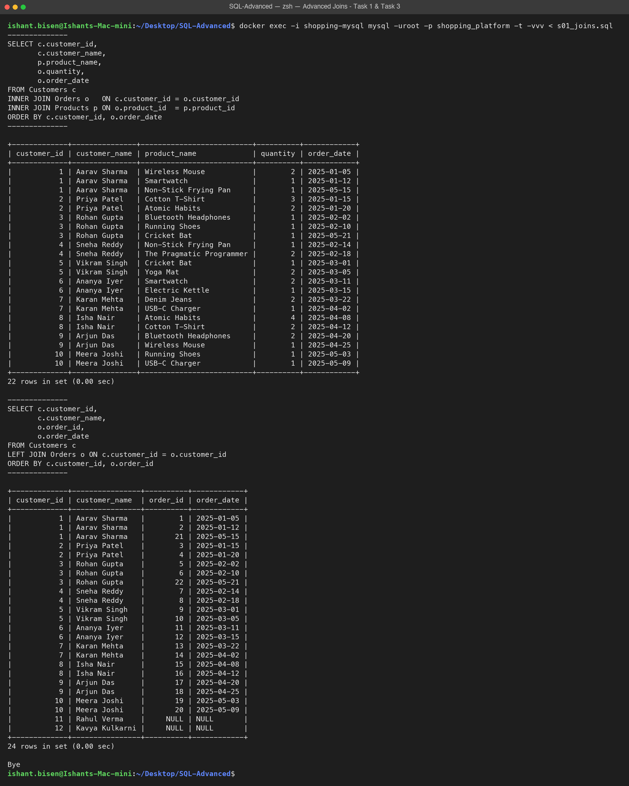
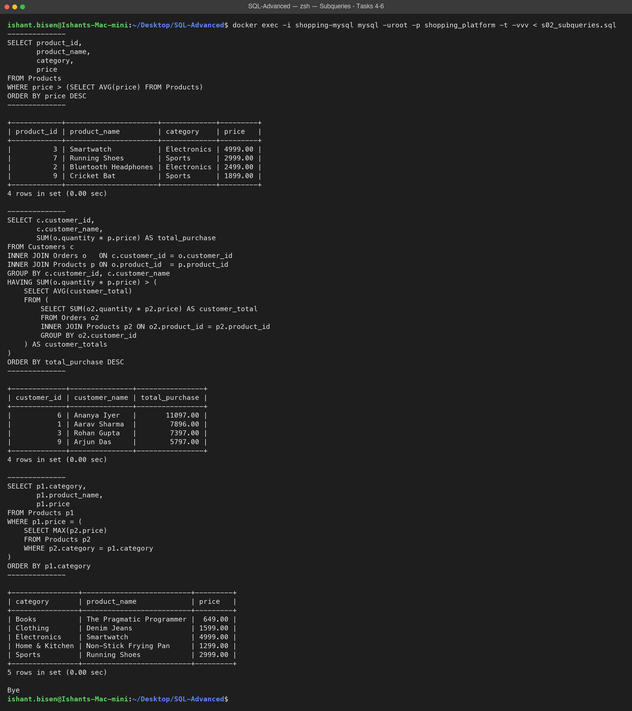
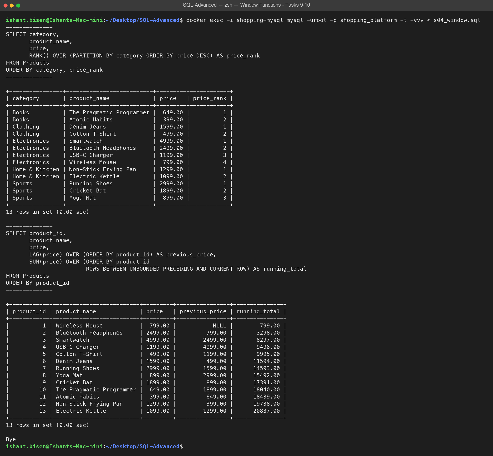
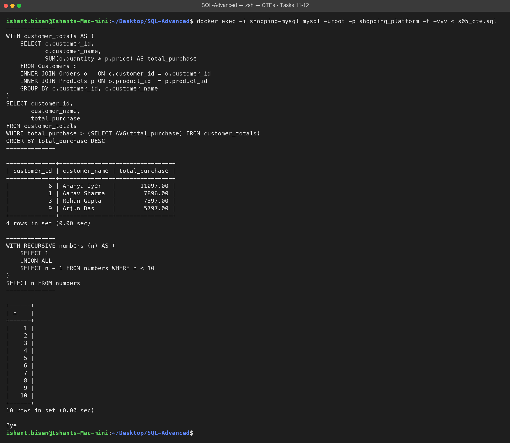
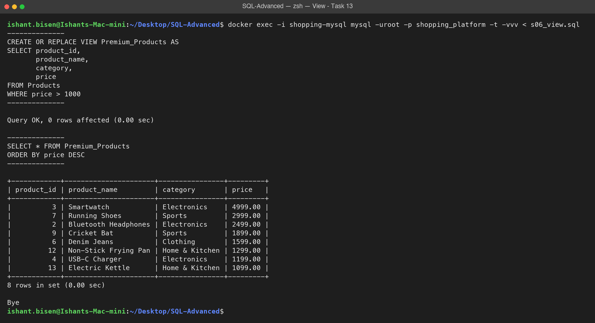
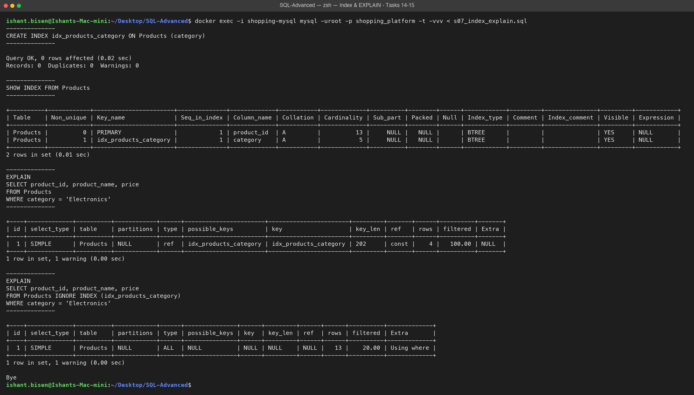
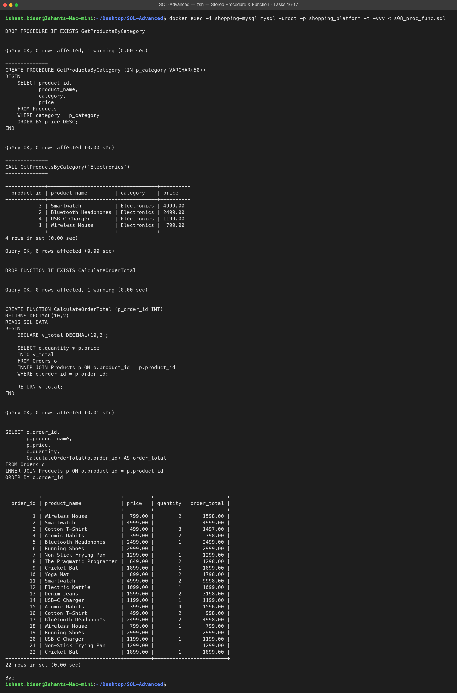
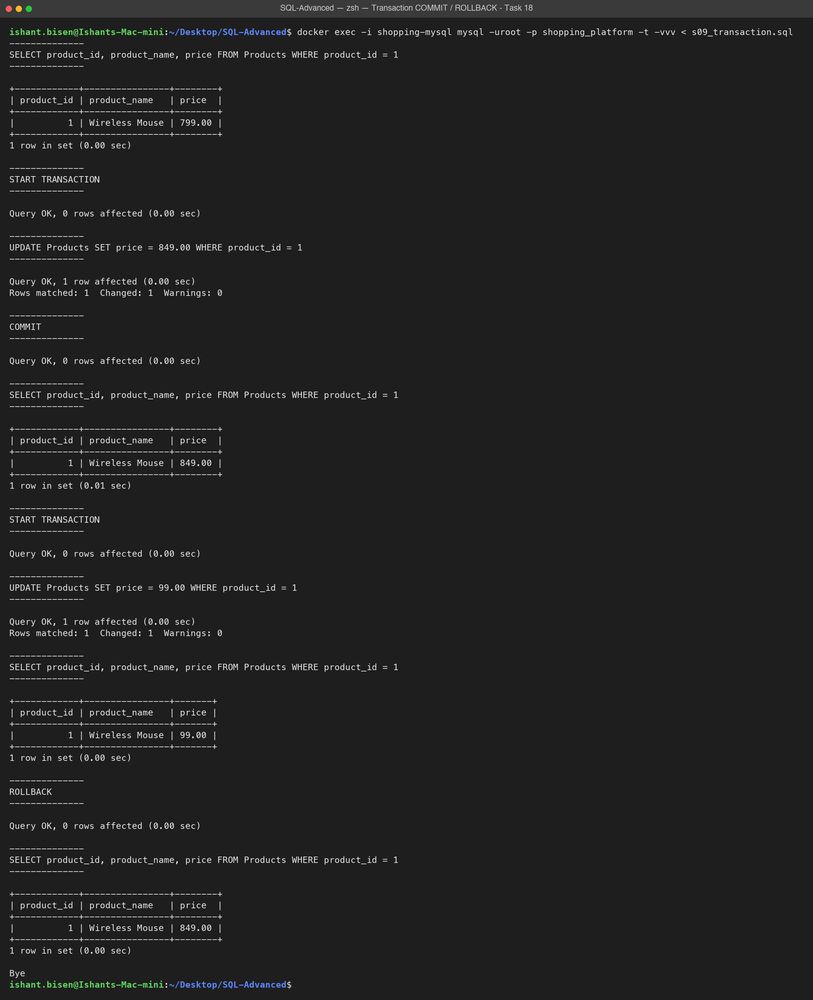
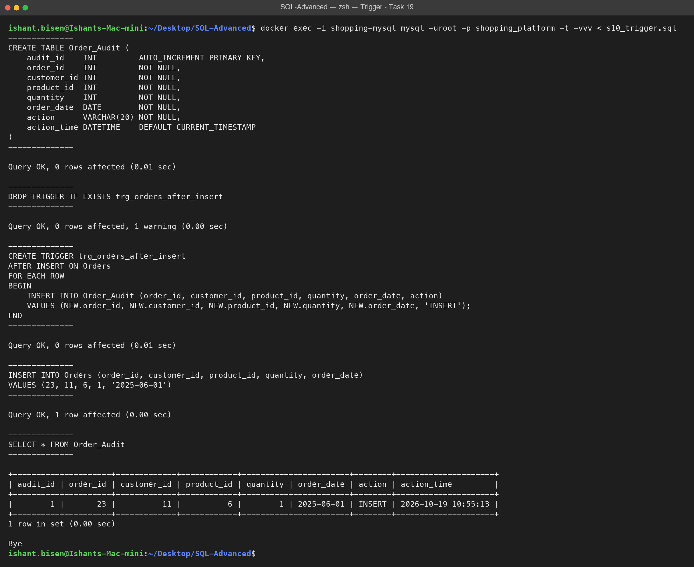

# Online Shopping Platform – Advanced SQL Assignment

**Author:** Ishant Bisen (ishant.bisen@rajasoftwarelabs.com)

## Assignment Overview

As a Database Developer for an online shopping platform, the goal of this assignment is to build advanced
SQL solutions for business reporting, sales analysis, database automation, transaction management and
query optimization on a database of customers, products and orders.

The assignment covers:

| Section | Topic | Tasks |
|---|---|---|
| 1 | Advanced Joins (`INNER`, `CROSS`, `LEFT`) | 1 – 3 |
| 2 | Subqueries (scalar, derived table, correlated) | 4 – 6 |
| 3 | Set Operations (`UNION`, `INTERSECT` / `EXCEPT` alternatives) | 7 – 8 |
| 4 | Window Functions (`RANK`, `LAG`, running total) | 9 – 10 |
| 5 | Common Table Expressions (CTE, recursive CTE) | 11 – 12 |
| 6 | Views | 13 |
| 7 | Indexes and Query Performance (`CREATE INDEX`, `EXPLAIN`) | 14 – 15 |
| 8 | Stored Procedures and Functions | 16 – 17 |
| 9 | Transactions (`COMMIT`, `ROLLBACK`) | 18 |
| 10 | Triggers | 19 |
| 11 | Performance Tuning | 20 |

All statements are in a single script, [`shopping_platform.sql`](shopping_platform.sql), organised
section-wise with `-- Section N` and `-- Task N` comments.

**Database:** MySQL 8.0 (run in Docker)

## Repository Structure

```
.
├── shopping_platform.sql   # CREATE TABLE, sample INSERTs, all task solutions and database objects
├── docker-compose.yml      # Starts a MySQL 8.0 container on port 3307
├── screenshots/            # Execution screenshots
├── SUBMISSION.md           # Repository, PR and branch links
└── README.md
```

## Database Schema

```
Customers (1) ────< (many) Orders (many) >──── (1) Products
```

### Customers

| Column | Data Type | Constraints |
|---|---|---|
| customer_id | INT | PRIMARY KEY |
| customer_name | VARCHAR(100) | NOT NULL |
| city | VARCHAR(50) | |
| email | VARCHAR(100) | NOT NULL, UNIQUE |

### Products

| Column | Data Type | Constraints |
|---|---|---|
| product_id | INT | PRIMARY KEY |
| product_name | VARCHAR(100) | NOT NULL |
| category | VARCHAR(50) | NOT NULL |
| price | DECIMAL(10,2) | NOT NULL |
| created_date | DATE | used by the Task 20 tuning query |

### Orders

| Column | Data Type | Constraints |
|---|---|---|
| order_id | INT | PRIMARY KEY |
| customer_id | INT | NOT NULL, FOREIGN KEY → Customers(customer_id) |
| product_id | INT | NOT NULL, FOREIGN KEY → Products(product_id) |
| quantity | INT | NOT NULL |
| order_date | DATE | NOT NULL |

### Order_Audit (Task 19)

| Column | Data Type | Constraints |
|---|---|---|
| audit_id | INT | AUTO_INCREMENT PRIMARY KEY |
| order_id, customer_id, product_id, quantity | INT | NOT NULL |
| order_date | DATE | NOT NULL |
| action | VARCHAR(20) | NOT NULL |
| action_time | DATETIME | DEFAULT CURRENT_TIMESTAMP |

### Sample Data

- **12 customers** from 12 Indian cities. Rahul Verma and Kavya Kulkarni intentionally have no orders,
  so they appear with `NULL` in the LEFT JOIN (Task 3).
- **13 products** across 5 categories: Electronics, Clothing, Sports, Books, Home & Kitchen.
- **22 orders** between January and May 2025.

## Steps to Execute the SQL Script

### Prerequisites

- [Docker Desktop](https://www.docker.com/products/docker-desktop/) installed and running

### 1. Clone the repository

```bash
git clone https://github.com/ishantbisen-cmd/ishant-bisen-sql-advanced.git
cd ishant-bisen-sql-advanced
git checkout feature/sql-advanced-assignment
```

### 2. Start MySQL

```bash
docker compose up -d
```

Check that the server is ready:

```bash
docker exec shopping-mysql mysqladmin ping -uroot -proot
# mysqld is alive
```

### 3. Run the full script

```bash
docker exec -i shopping-mysql mysql -uroot -proot --table < shopping_platform.sql
```

The script starts with `DROP DATABASE IF EXISTS shopping_platform;`, so it can be re-run at any time. It
creates the database, tables, sample data and all database objects, and prints the result of every task.

To also print each statement above its result (as in the screenshots), add `-vvv`:

```bash
docker exec -i shopping-mysql mysql -uroot -proot --table -vvv < shopping_platform.sql
```

### 4. Run individual queries (optional)

```bash
docker exec -it shopping-mysql mysql -uroot -proot shopping_platform
```

Then paste any query from `shopping_platform.sql`, for example `CALL GetProductsByCategory('Sports');`.

A GUI client (MySQL Workbench, DBeaver, etc.) can also connect using:

| Host | Port | User | Password | Database |
|---|---|---|---|---|
| 127.0.0.1 | 3307 | root | root | shopping_platform |

### 5. Stop MySQL

```bash
docker compose down
```

## Summary of Implemented Advanced SQL Concepts

| Concept | Where | What it does |
|---|---|---|
| INNER / CROSS / LEFT JOIN | Tasks 1–3 | Customer-product purchases, all 156 customer × product combinations, and customers with no orders shown as `NULL` |
| Scalar subquery | Task 4 | Products priced above `AVG(price)` |
| Derived table in `HAVING` | Task 5 | Customers whose total spend is above the average customer spend |
| Correlated subquery | Task 6 | Highest-priced product per category |
| `UNION` | Task 7 | Electronics and Sports products in one result |
| `INTERSECT` / `EXCEPT` alternatives | Task 8 | `INNER JOIN` for customers who bought both Electronics and Sports; `LEFT JOIN ... IS NULL` for Electronics-only buyers |
| `RANK()`, `LAG()`, `SUM() OVER` | Tasks 9–10 | Price rank within category, previous price and running total |
| CTE / recursive CTE | Tasks 11–12 | Above-average customers; numbers 1 to 10 |
| View | Task 13 | `Premium_Products` (price > ₹1,000) |
| Index + `EXPLAIN` | Tasks 14–15 | `idx_products_category` changes the plan from a full scan (`type = ALL`, 13 rows) to an index lookup (`type = ref`, 4 rows) |
| Stored procedure | Task 16 | `GetProductsByCategory(category)` |
| Function | Task 17 | `CalculateOrderTotal(order_id)` returns price × quantity |
| Transaction | Task 18 | `COMMIT` keeps the new price (₹849); `ROLLBACK` undoes a temporary ₹99 change |
| Trigger | Task 19 | `trg_orders_after_insert` writes every new order into `Order_Audit` |
| Performance tuning | Task 20 | Removes `SELECT *` and `DISTINCT`, replaces `YEAR(created_date)` with a date range, and adds a composite `(category, created_date)` index; `EXPLAIN` moves from `ref` (key_len 202) to `range` (key_len 206), so both index columns are used |

## Screenshots

Each screenshot shows the terminal output of one section of `shopping_platform.sql`, run with
`mysql -t -vvv` against the Docker container.

### Advanced Join (Tasks 1 & 3)



### Subqueries (Tasks 4–6)



### Window Functions (Tasks 9–10)



### CTEs (Tasks 11–12)



### View (Task 13)



### Index and EXPLAIN (Tasks 14–15)



### Stored Procedure and Function (Tasks 16–17)



### Transaction COMMIT / ROLLBACK (Task 18)



### Trigger (Task 19)



### Additional Screenshots

| Task | Screenshot |
|---|---|
| Tasks 7–8 – Set Operations | [task07_08_set_operations.png](screenshots/task07_08_set_operations.png) |
| Task 20 – Performance Tuning | [task20_performance_tuning.png](screenshots/task20_performance_tuning.png) |
